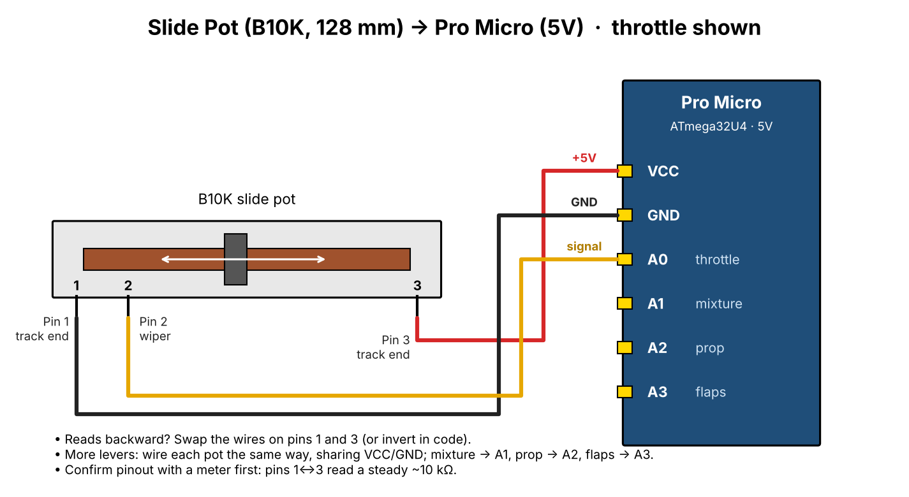
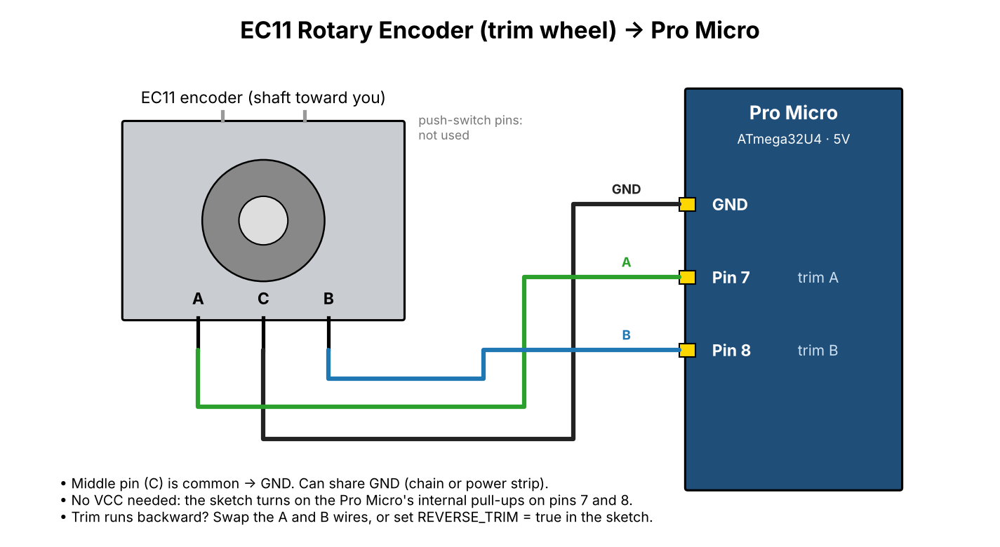

# Firmware: whole panel as one USB controller

[`c172_panel/c172_panel.ino`](c172_panel/c172_panel.ino) turns an **Arduino Pro Micro** (or Leonardo) into a game controller with 4 axes and 16 buttons. Windows and MSFS see it as a joystick, so no extra software is needed.

As far as I know, the GP-Wiz is a button-only board, so it can't read the throttle, mixture and prop potentiometers. One Pro Micro (about $10) handles everything on this panel.

| Input | Pin | Shows up as |
|---|---|---|
| Throttle pot wiper | A0 | X axis |
| Mixture pot wiper | A1 | Y axis |
| Prop pot wiper | A2 | Z axis (set `HAS_PROP = true`) |
| Flap lever pot wiper | A3 | Rx axis (set `HAS_FLAPS = true`) |
| Parking brake microswitch (COM → GND, NC → pin) | 2 | Button 1 held while set; 2 = "just set" pulse; 3 = "just released" pulse |
| Fuel selector LEFT / BOTH / RIGHT / OFF (common → GND) | 3 / 4 / 5 / 6 | Buttons 4 / 5 / 6 / 7 held |
| Trim encoder A / B (middle → GND) | 7 / 8 | Button 8 pulse per click nose down, button 9 nose up |

Pots: wire the two ends to VCC and GND, and the wiper to the pin.

Encoder: middle pin (C) to GND, the outer pins (A, B) to pins 7 and 8. No VCC needed; the sketch uses the internal pull-ups.

## Install

1. Install the Arduino IDE.
2. Add the **Joystick** library by Matthew Heironimus: download https://github.com/MHeironimus/ArduinoJoystickLibrary as a ZIP, then use *Sketch → Include Library → Add .ZIP Library*.
3. Open `c172_panel.ino`, choose the board **Arduino Leonardo** (this works for the Pro Micro too) and upload.
4. **Calibrate:** move the throttle, mixture, prop and flap lever end to end once. The throttle, mixture and prop use nearly all of the pots' travel, and the flap lever about 60 mm of it; either way the sketch learns where each one stops and stretches that to the full axis. It saves the ranges in EEPROM, so you only do this once. To start over, set `RESET_CALIBRATION = true`, upload, set it back to `false` and upload again.
5. In Windows, open *Set up USB game controllers* to check the axes and buttons.

### If it says `Joystick.h: No such file or directory`

The Joystick library isn't installed. It isn't in the IDE's Library Manager, so it has to come from GitHub:

1. Go to [github.com/MHeironimus/ArduinoJoystickLibrary](https://github.com/MHeironimus/ArduinoJoystickLibrary), click the green **Code** button and choose **Download ZIP**.
2. In the Arduino IDE: *Sketch → Include Library → Add .ZIP Library…* and pick that ZIP. Don't unzip it first.
3. Restart the IDE and compile again.

If the IDE says the ZIP isn't a valid library, unzip it and copy the library folder (the one that holds `src` and `library.properties`) into `Documents\Arduino\libraries\`, renamed to `Joystick` (drop the `-master` ending). Restart the IDE.

### If it complains about `PluggableUSB` or `HID`

The board setting is wrong. The library only works on boards with built-in USB, so choose **Tools → Board → Arduino Leonardo** (or *SparkFun Pro Micro, 5V/16MHz* if you've installed SparkFun's board package), not Uno or Nano.

The settings at the top of the sketch reverse axes or the trim direction, and set the number of encoder steps per click.

The sketch passes a syntax check but hasn't been tested on real hardware yet.
