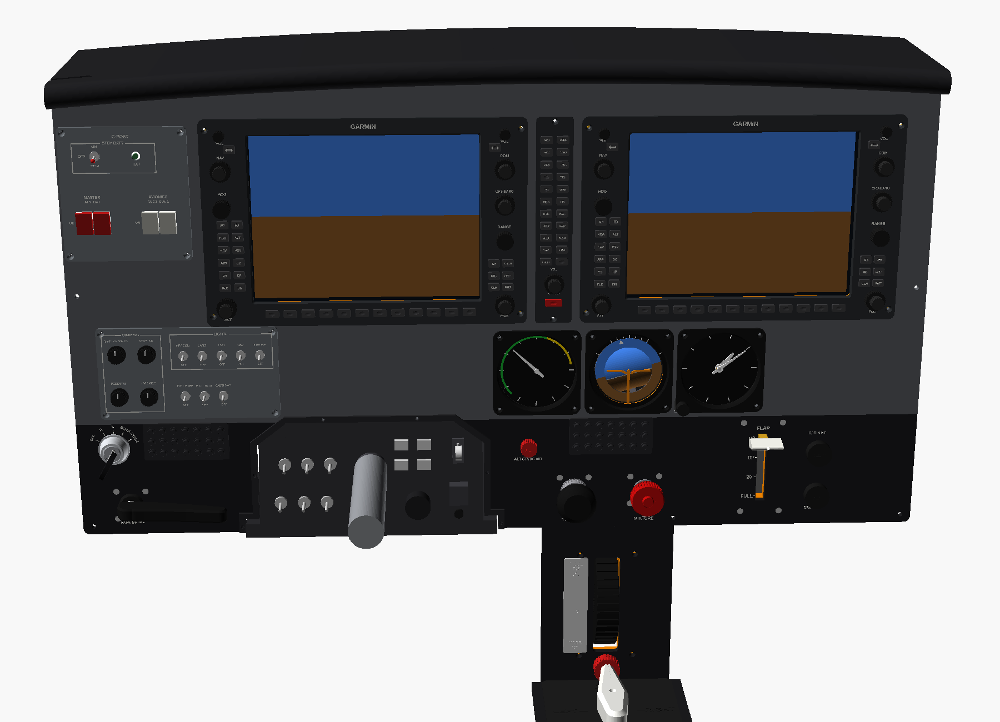
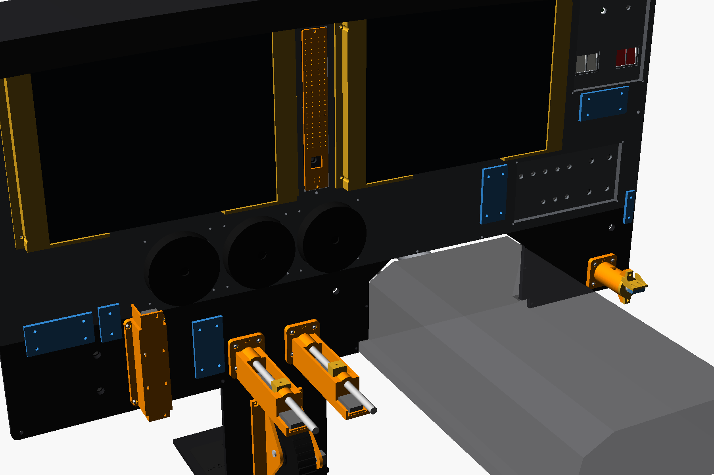
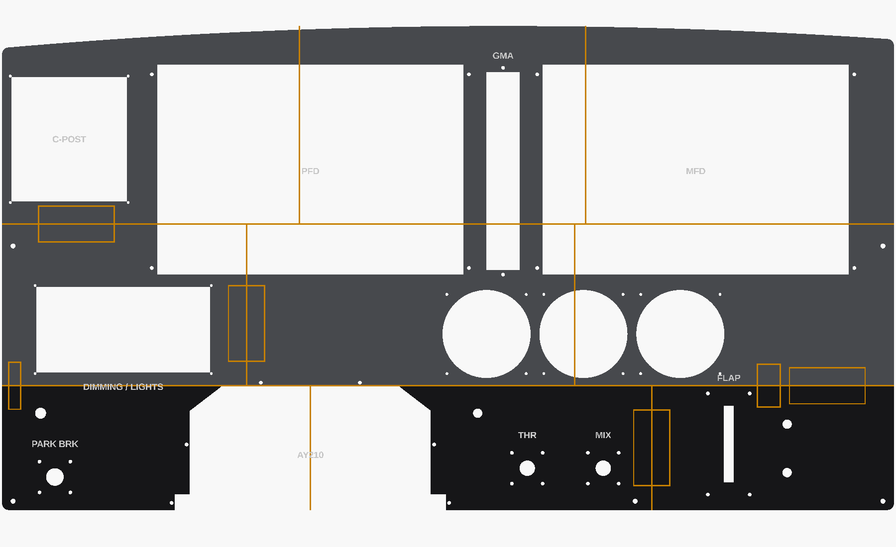
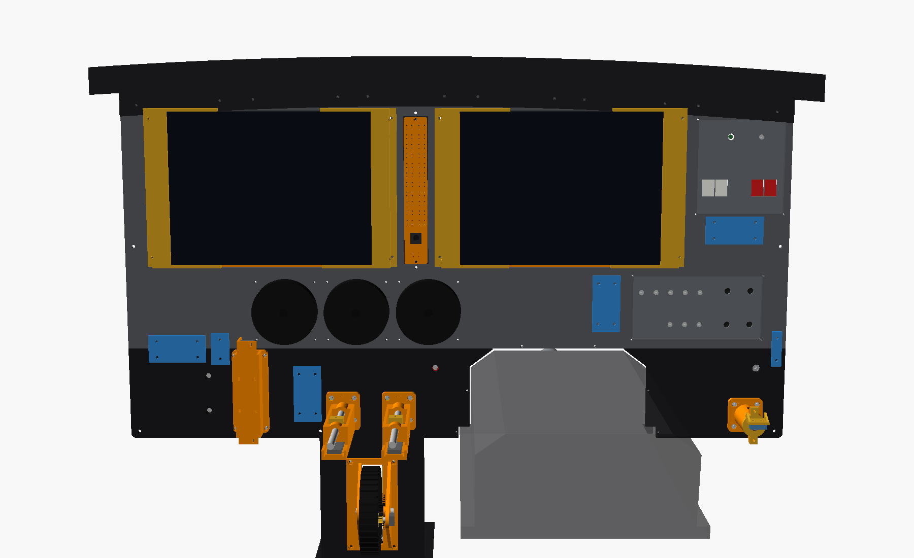
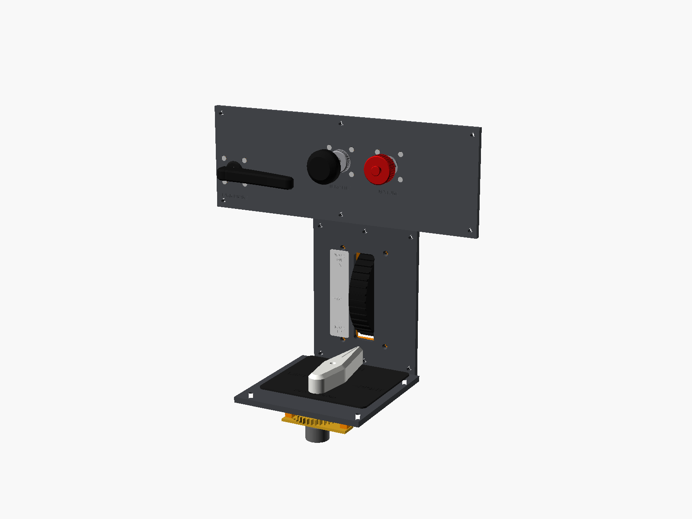
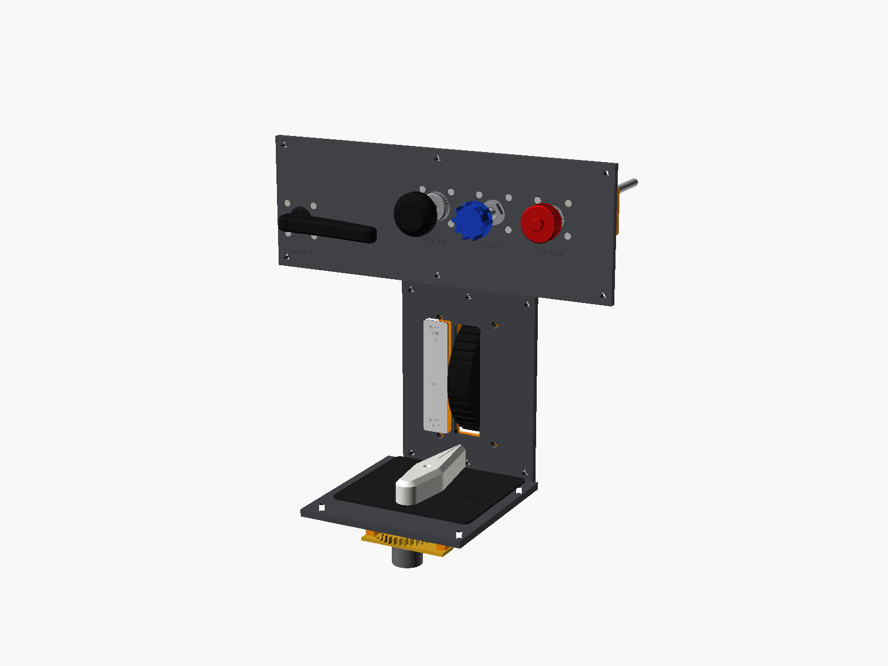
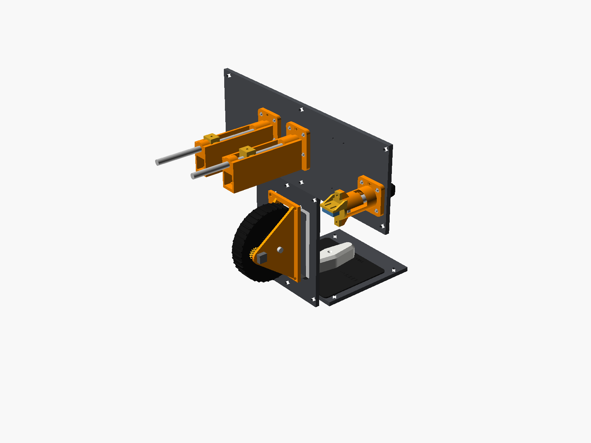
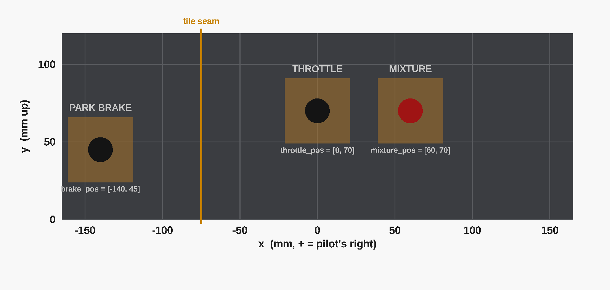

# Printable Panels

There are two panel options:

1. **[G1000 dashboard](#g1000-dashboard)**: the full 172S G1000 panel, shortened to about 32" (810 mm), with every control. This is the main one.
2. **[Simple lower panel](#simple-lower-panel)**: just the parking brake, throttle, mixture (and prop) plus the pedestal. Good for testing the controls before building the whole dashboard.

---

## G1000 dashboard

| Behind the panel (AY210 base see-through) | Layout and print tiles |
|---|---|
|  |  |

Laid out from photos of the real 172S NAV III panel and kept at real scale; only the copilot side is cut off.

| Area | What's there |
|---|---|
| Upper (grey) | C-post switches, PFD, GMA 1347 audio panel, MFD, dimming/lights panel, standby airspeed / attitude / altimeter |
| Lower (black) | Ignition key, circuit breakers (look only), parking brake, **window for the Moza AY210's front panel**, ALT STATIC AIR, throttle, mixture, flap lever, cabin heat / cabin air |
| Pedestal | Elevator trim wheel, fuel shutoff knob, floor plate with the fuel selector |
| Top | Glareshield in 4 segments |

### Printing it

- **Tiles:** 9 of them, 3 per row, sized for a 305 × 305 mm bed (QIDI Plus4). Row L (lower) in black; rows M and U in grey. Print them **front face down**. The largest is 298 × 147 mm. For a smaller printer, set `bed` and move the seams in `lower_splits`, `mid_splits` and `upper_splits` (up to 5 tiles per row); OpenSCAD warns if a tile is too wide.
- **Joining:** see [Joining the pieces](#joining-the-pieces) below.
- **Or cut it on a CNC router:** [`dashboard/cnc`](dashboard/cnc) has layered DXF / SVG files for cutting the panel from 1/4" plywood or MDF in 4 pieces (plus the pedestal plates), sized for an 800 × 400 mm router like the FoxAlien XE-PRO 8040.
- **Glareshield:** 4 segments. Print them upside down with tree supports, or use them as formers and cover with foam and vinyl like the real padded one.
- **Pedestal:** the face and floor plates.
- **Full-size template:** [`dashboard/templates/`](dashboard/templates) has the whole panel as one SVG/DXF (front view), for a big laser or to print and check the layout.
- **Mounting to your frame:** 4.5 mm holes along the bottom edge and the sides take #8 / M4 screws.

STLs are in [`dashboard/stl/`](dashboard/stl). After changing anything, regenerate them with `scripts/render.sh dashboard`.

### Fitting it to your Moza AY210

The AY210's whole front panel (its toggles, buttons, rotary, gear and flap levers and the yoke shaft) sits **flush in a window in the lower panel**, in front of the pilot. So all its switches stay in reach, and the yoke comes straight out of the dashboard.

- **The window** follows the base's front face from Moza's drawing: the 243 mm foot plate across the bottom, the 215.8 mm body above it, and the chamfered top corners, 111.3 mm tall, with a 1.5 mm gap all round (`moza_gap`). By default the base stands on the same surface as the dashboard (`moza_bottom = 0`), so the window opens through the bottom edge.
- **Trim frame:** print `moza_frame` (3 mm thick, 6 mm lip) and screw it on round the window with 6 × M3 countersunk screws and nuts behind. It hides the gap and also ties the lower panel pieces either side of the window to the panel above.
- **Sliding the base in:** push the base forward through the window until its face is flush with the panel at the yoke shaft. The face leans back about 12°, so the bottom row of switches ends up a little proud and the top a little behind; that's normal.
- **Yoke height:** the shaft centre is 66 mm above the bottom of the base (`moza_shaft_h`, read off Moza's drawing). If you put the base on a riser, set `moza_bottom` to its height and the window moves up with it.
- **Clearance:** nothing else on the panel may overlap the window or the frame; the file warns if something does. The parking brake, ignition and breakers moved left of it, and ALT STATIC AIR and the second breaker strip moved right.

### Changing the layout

Every position is a setting near the top of [`g1000_dashboard.scad`](g1000_dashboard.scad), in mm from the pilot's centre line (`x`, + = right) and up from the panel bottom (`y`): `pfd_pos`, `gma_pos`, `mfd_pos`, `cpost_pos`, `lights_pos`, `gauge_*`, `moza_x` / `moza_bottom` (the AY210 window), `ignition_pos`, `brake_pos`, `throttle_pos`, `mixture_pos`, `flap_pos`, and so on. You can also change the panel width (`x_left`, `x_right`), the top arch, the tile seams and your `bed` size. OpenSCAD warns if a tile won't fit your printer.

---

## Joining the pieces

The tiles (or CNC pieces) butt together and are joined from the back in three ways:

1. **Splice plates** (blue above) straddle the seams and the two row joints. Each screws into **blind pilot holes** already in the back of the pieces, so nothing shows on the front. `scripts/place_splices.py` finds room for them clear of everything mounted behind the panel and writes their positions to [`splices.scad`](splices.scad). For the printed tiles that's:
   - 4 × `splice` (34 × 70 mm, 4 screws), across the right-hand lower seam, the middle-row seam and the two row joints
   - 1 × `splice_small` (40 × 22 mm, 2 screws) and 1 × `splice_narrow` (44 × 12 mm, 2 screws), for tight spots on the lower/middle row joint

   Print them flat, 4 mm thick (`panel/dashboard/stl/splice.stl`, `splice_small.stl`, `splice_narrow.stl`). Spread glue on the plate (CA or epoxy for PLA/PETG), press it on over its holes, and drive **M3 × 8** screws (4 mm into the panel; longer ones come through the front). The same plate turns 90° for the horizontal joints.
2. **The bezels, gauges and the AY210 trim frame** cover the seams that have no room for a plate (through the PFD, the MFD, the attitude gauge and the AY210 window). Their screws go into the pieces on both sides, so each one acts as a splice. The trim frame is what holds the lower-left piece (ignition, parking brake) to the rest.
3. **The glareshield** is split at different places from the upper tiles (`glareshield_splits`; by default halfway along each tile). Each glareshield piece screws into the tiles on both sides of a seam, which ties the top edge.

**Order:** lay the tiles face down on a flat table and glue and screw the splice plates. Then stand the panel up and fit the bezels, gauges and glareshield. Last, screw the panel to your frame through the frame holes along the bottom and sides.

If you move controls or change the seams, run `python3 scripts/place_splices.py` (needs `pip install shapely`) before re-rendering; `scripts/render.sh dashboard` does it for you. It prints each seam's plates, and says when a seam has no room for one.

## Simple lower panel

Panel pieces with every control's cutouts, mounting holes and countersinks already in place. The layout follows the 172S lower panel and centre pedestal.

| With the optional prop control | Behind the panel |
|---|---|
|  |  |

## Pieces

| Piece | What's on it | Size | STL |
|---|---|---|---|
| Lower panel | Parking brake, throttle, (prop), mixture, engraved labels | 330 × 120 mm, split into 2 tiles | `lower_tile_1`, `lower_tile_2` + `splice` |
| Pedestal face | Trim wheel slot + placard outline | 130 × 170 mm | `pedestal` |
| Pedestal floor | Fuel selector | 150 × 150 mm | `floor` |

- **Thickness:** all pieces are `panel_thickness` thick (6.35 mm by default, set in `common/sim_common.scad`).
- **Printing:** print **front face down** for a smooth face; the engraved labels print correctly that way.
- **Joining the lower panel:** the tiles butt together. Glue the `splice` strip across the seam on the back, plus 4 × M3 × 8 screws into the blind pilot holes.
- **Mounting:** the 4.5 mm holes around the edges are for #8 or M4 screws into your frame.
- **Cutting from plywood instead:** [`templates/`](templates) has full-size SVG and DXF files (front view) for a laser or CNC, or to print and drill through.

## Changing the layout

The easiest way is the drag-and-drop page [`tools/panel-layout.html`](../tools/panel-layout.html). See **[Moving the controls](../README.md#moving-the-controls)** in the main README for the full guide.

Open `c172_panel.scad` in OpenSCAD and use the Customizer:

- **Control positions:** `brake_pos`, `throttle_pos`, `prop_pos`, `mixture_pos`, in mm right of panel centre and up from the panel bottom.
- **Prop:** `has_prop` adds the blue prop knob between the throttle and mixture.
- **Yoke:** `yoke_hole = [x, y, w, h]` cuts an opening for a yoke shaft. Your Moza AY210 sits on the desk, so leave it empty unless the yoke shaft has to pass through this panel.
- **Labels:** `labels` turns the engraved labels on or off.
- **Bed size:** `bed` (your print bed size) and `lower_splits` (where tiles split). OpenSCAD warns if a tile is too big.

The positions are approximate 172S proportions taken from photos, not from factory drawings. Move them to suit your seat, yoke and monitor.

## Not included (already on your Moza AY210)

The yoke has its own buttons and hats, so those aren't modelled. The AY210 base's 13 switches sit in the dashboard's window, so you can bind them to whatever you like alongside the C-post and lights panels.
