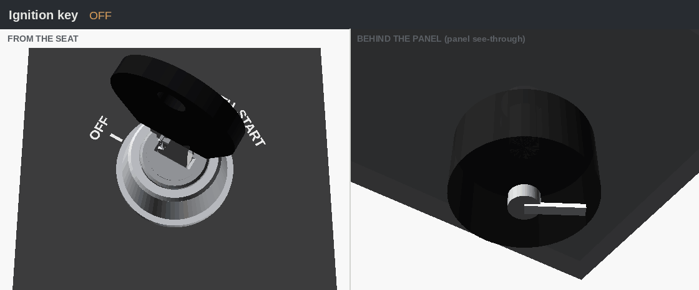
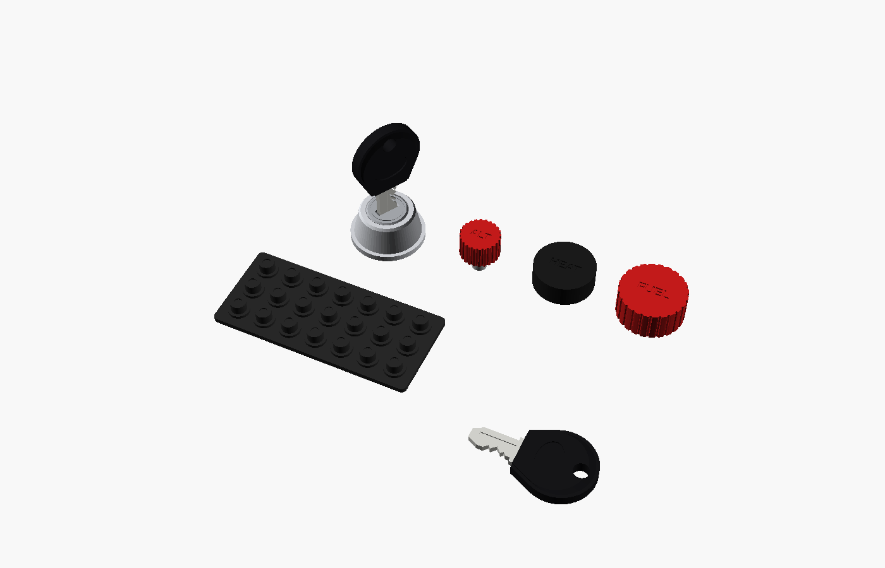

# Panel extras

| Part | What it is |
|---|---|
| `ignition_key`, `ignition_cylinder`, `ignition_escutcheon` | A real-looking key (bitted blade, black head with a key-ring hole) in a lock face with a chrome-look bezel, on a 1-pole 12-position rotary switch (stop washer set to 5 positions). OFF R L BOTH START is engraved round it on the panel. |
| `knob_alt_static` | Red ALT STATIC AIR knob (look only) |
| `knob_cabin_heat`, `knob_cabin_air` | CABIN HT / CABIN AIR knobs (look only) |
| `knob_fuel_shutoff` | Red FUEL SHUTOFF knob on the pedestal (look only) |
| `knob_stem` + `stem_clip` | Holds any look-only knob in an 8.5 mm panel hole |
| `cb_strip` | A block of circuit-breaker heads; glue two on the lower panel |
| `yoke_boot` | Trim ring with a rubber-boot look round a yoke shaft hole (`yoke_hole_d`, default 60 mm); not used on the G1000 dashboard, where the AY210 sits in a window |

Print the knobs face down; their label is engraved in the face, so fill it with white paint.

**Ignition key:** the lock face (`ignition_cylinder`) presses onto the rotary switch's 6 mm shaft and turns with it; the bezel (`ignition_escutcheon`) sits over the switch nut and stays still. **Cut the switch shaft so it ends 9 mm in front of the panel face**, so it reaches into the lock. The key's tip is a snug push fit in the keyway, and pulls out like a real key. Print the key flat in silver and change to black filament at 2.4 mm for the head (or paint the head). Print the lock face in grey and the bezel in silver.

