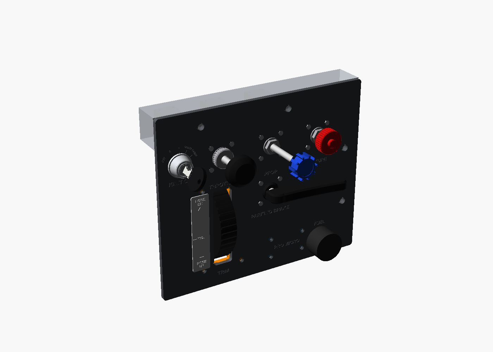
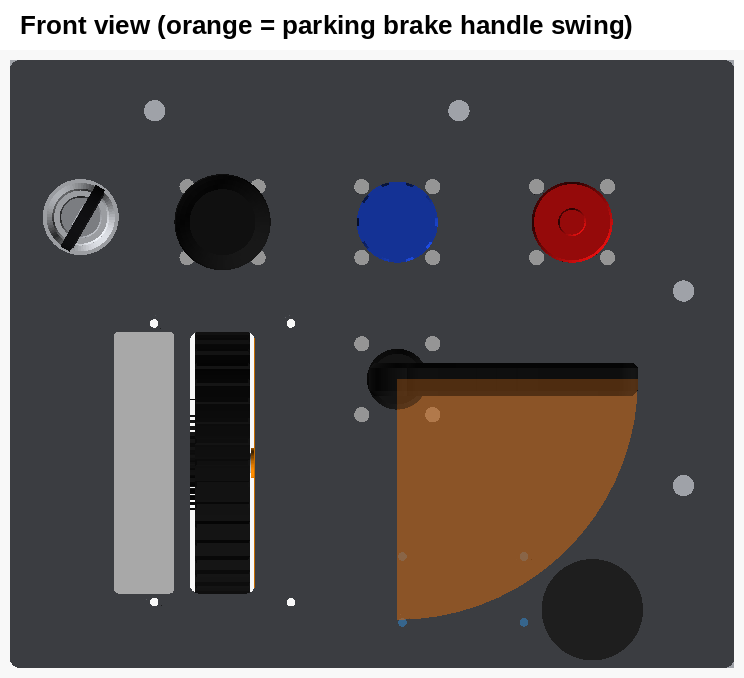
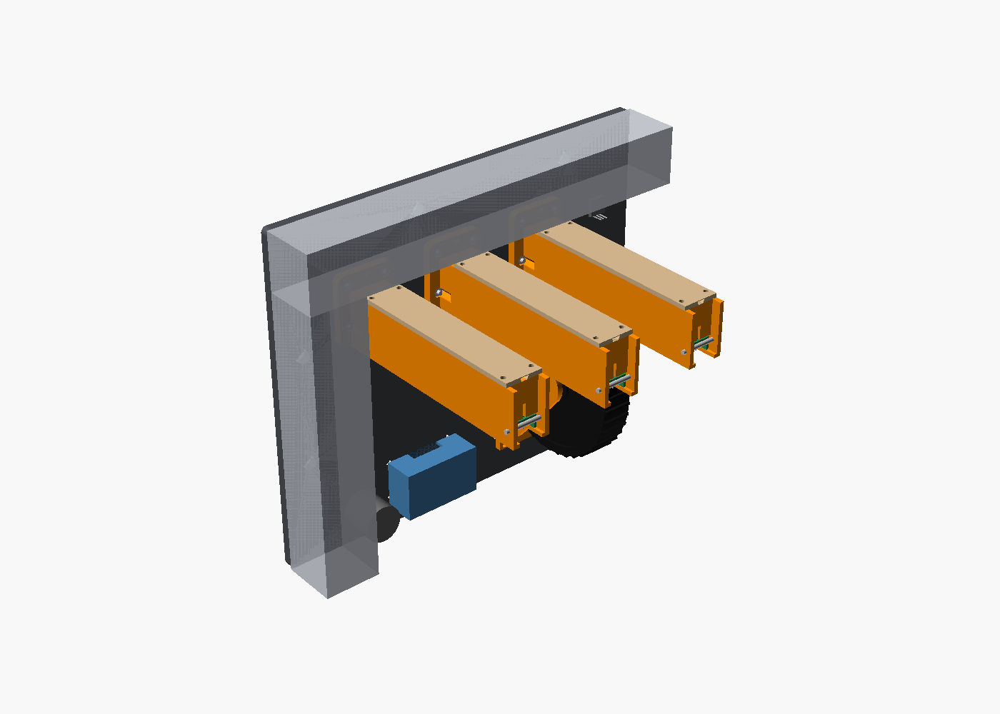
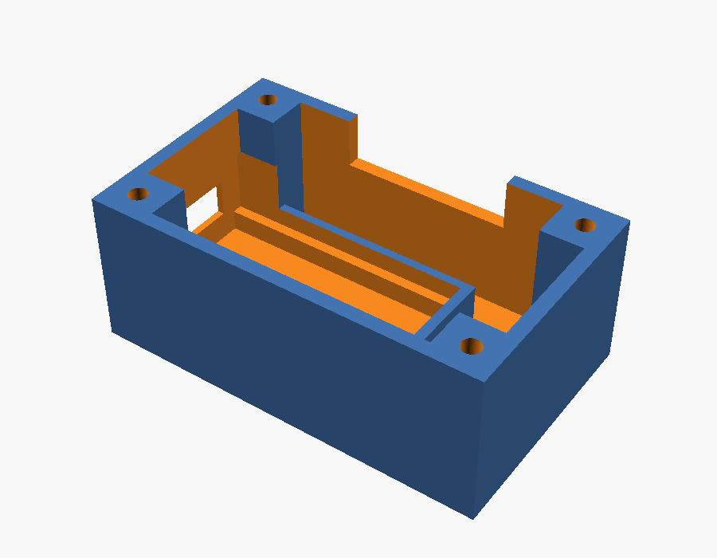

# Test panel

**Download:** [throttle_mixture_prop_all.zip](https://github.com/SFXShannon/c172-home-sim/raw/main/parts/push-pull-test-plate/throttle_mixture_prop_all.zip): this panel and the Pro Micro box, plus every throttle, mixture and prop file, in one zip.

A flat bench panel for building, wiring and testing the controls before the dashboard exists. Every hole and countersink is the same as on the real panel.

## What's on it (as seen from the seat)

| Spot | What | Hole |
|---|---|---|
| Top left | **Ignition key** on an EC11 rotary encoder, with OFF / R / L / BOTH / START engraved round it | 7.2 mm hole; a 13.6 mm square pocket in the back thins the plate to 2 mm so the encoder's short bushing reaches through |
| Top row | **Throttle, prop, mixture**, 69 mm apart (same as the dashboard) | 14 mm + 4 countersunk M3 on a 28 mm square |
| Under the throttle | **Elevator trim wheel** | 26 × 104 mm slot + 4 countersunk M3 at ±27 / ±55 mm. Glue the placard on the pilot's left of the slot |
| Under the prop | **Parking brake**, handle stows pointing right | 16 mm + 4 countersunk M3 on a 28 mm square |
| Lower right corner | **Fuel selector** | 12.5 mm plain hole, outside the parking brake handle's swing (room for a knob up to 40 mm across) |
| Lower middle | **Pro Micro box**, screws on behind | 4 countersunk M3 |

The panel is **286 × 240 mm**, 6.35 mm thick, and completely flat (no bosses), so it prints quickly and fits a 305 mm bed. Labels are engraved 0.6 mm into the front.

Nothing collides, behind the panel or in front. That covers the parking brake stowed, set and everything in between, and the key turned anywhere from OFF to START.

## Extrusion mount

Four 8 mm bolt holes, two along the top edge and two down the right edge, centred on 40 mm extrusion (4040). Everything behind the panel stays 3 mm clear of the 40 mm strips. The holes are 8.4 mm so an M8 or 5/16" bolt drops through after printing; set `bolt_hole_d = 8` for exactly 8 mm. For 2020 or 1" extrusion, set `rail_w`.

## Ignition key

Uses the key, lock face and bezel from [`../panel-extras`](../panel-extras) (`ignition_key`, `ignition_cylinder`, `ignition_escutcheon`). The lock face presses onto the encoder's 6 mm D shaft, the same as the rotary switch it was drawn for.

- Mount the EC11 from behind in the pocket, nut on the front. The bezel covers the nut.
- **Cut the encoder shaft to 11 mm from its mounting face.** It then ends 9 mm in front of the panel and reaches into the lock.
- An encoder turns all the way round with no end stops. The OFF / R / L / BOTH / START marks are just a guide.

## Pro Micro box

`stl/pro_micro_box.stl`: a 56 × 34 × 22 mm cup that screws on behind the panel, so the panel is its lid. Use 4 × **M3 × 16** countersunk screws from the front into the corner posts.

- The board (Type-C Pro Micro, about 35 × 18.3 mm) drops onto two ledges, with its USB-C end pushed against the opening in the end wall. A strip of double-sided foam tape on the ledges holds it. If yours measures differently, set `pm_size`.
- The USB-C opening faces the pilot's left, toward the trim wheel.
- Wires come in through the notch in the rim.
- Prints floor down, no supports.

## Printing

- `stl/plate.stl`: front face down, no supports.
- `stl/pro_micro_box.stl`: floor down.
- See the throttle, trim wheel and parking brake folders for their parts.

## Wiring (Pro Micro sketch in [`/firmware`](../../firmware))

| Control | Pin |
|---|---|
| Throttle pot wiper | A0 |
| Mixture pot wiper | A1 |
| Prop pot wiper | A2 (set `HAS_PROP = true`) |
| Parking brake microswitch (COM → GND, NC → pin) | 2 |
| Fuel selector LEFT / BOTH / RIGHT / OFF (common → GND) | 3 / 4 / 5 / 6 |
| Trim encoder A / B (middle → GND) | 7 / 8 |
| Ignition encoder A / B (middle → GND), push switch | 9 / 10, push switch 16 (free pins; the sketch doesn't read them yet) |

Pot ends go to VCC and GND.
