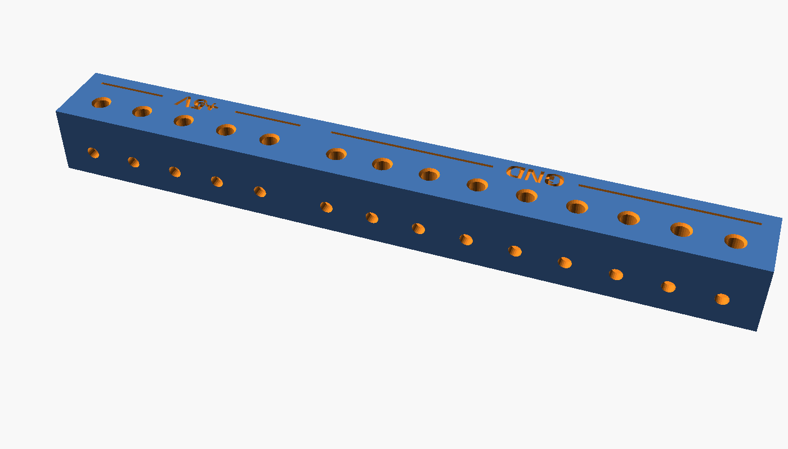
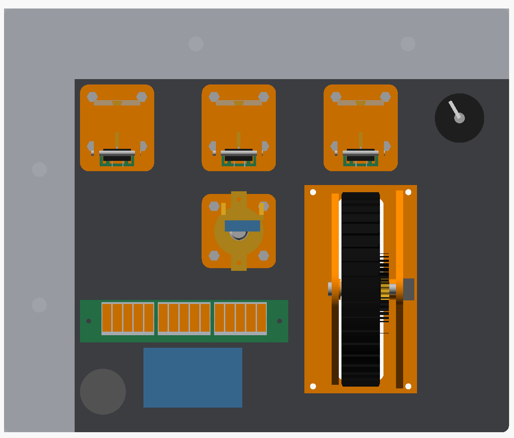

# Test panel

**Download:** [throttle_mixture_prop_all.zip](https://github.com/SFXShannon/c172-home-sim/raw/main/parts/push-pull-test-plate/throttle_mixture_prop_all.zip): this panel and the Pro Micro box, plus every throttle, mixture and prop file, in one zip.

A flat bench panel for building, wiring and testing the controls before the dashboard exists. Every hole and countersink is the same as on the real panel.

## What's on it (as seen from the seat)

| Spot | What | Hole |
|---|---|---|
| Top left | **Ignition key** on a 1-pole 12-position rotary switch (RS26 type), with OFF / R / L / BOTH / START engraved round it | 10 mm hole for the switch's threaded bushing |
| Top row | **Throttle, prop, mixture**, 69 mm apart (same as the dashboard) | 14 mm + 4 countersunk M3 on a 28 mm square |
| Under the throttle | **Elevator trim wheel** | 26 × 104 mm slot + 4 countersunk M3 at ±27 / ±55 mm. Glue the placard on the pilot's left of the slot |
| Under the prop | **Parking brake**, handle stows pointing right | 16 mm + 4 countersunk M3 on a 28 mm square |
| Lower right corner | **Fuel selector** | 12.5 mm plain hole, outside the parking brake handle's swing (room for a knob up to 40 mm across) |
| Lower middle | **Pro Micro box**, screws on behind | 4 countersunk M3 |
| Behind, between the parking brake and the Pro Micro box | **Power breakout** (GND and +5V) | 2 blind M3 pilot holes in the back, nothing on the front |

The panel is **286 × 240 mm**, 6.35 mm thick, and completely flat (no bosses), so it prints quickly and fits a 305 mm bed. Labels are engraved 0.6 mm into the front.

Nothing collides, behind the panel or in front. That covers the parking brake stowed, set and everything in between, and the key turned anywhere from OFF to START.

## Extrusion mount

Four 8 mm bolt holes, two along the top edge and two down the right edge, centred on 40 mm extrusion (4040). Everything behind the panel stays 3 mm clear of the 40 mm strips. The holes are 8.4 mm so an M8 or 5/16" bolt drops through after printing; set `bolt_hole_d = 8` for exactly 8 mm. For 2020 or 1" extrusion, set `rail_w`.

## Ignition key

Uses the key, lock face and bezel from [`../panel-extras`](../panel-extras) (`ignition_key`, `ignition_cylinder`, `ignition_escutcheon`) on a **1-pole 12-position rotary switch** (the RS26 type with a knurled 6 mm shaft and a threaded bushing).

- **Set the stop washer to 5 positions.** Lift the washer under the nut and drop its tab into the hole marked 5, so the switch only turns OFF → START.
- Mount the switch from behind through the 10 mm hole, lock washer and nut on the front. The bezel covers the nut. If the switch has a small locating tab that stops it sitting flat against the back of the panel, snip it off; the nut holds it.
- **Cut the shaft to about 20.5 mm from the switch's mounting face** (don't cut it if it's shorter). It then ends 14 mm in front of the panel and fills the lock's 10 mm bore.
- Glue the key's stub into the keyway once the lock is on.
- Turn the shaft fully anticlockwise (OFF), then press the lock face on with its keyway pointing at OFF. The knurl bites into the 5.9 mm bore. If you have a switch with a D shaft instead, set `ign_shaft = "d"` in `panel_extras.scad`.

## Pro Micro box

`stl/pro_micro_box.stl`: a 56 × 34 × 27 mm cup that screws on behind the panel, so the panel is its lid. Use 4 × **M3 × 16** countersunk screws from the front into the corner posts.

- The board (Type-C Pro Micro, about 35 × 18.3 mm) drops onto two ledges with its USB-C socket in the opening in the end wall. The opening is 10 mm wide and has 3 mm of extra room on the rim side for the cable plug's moulding (`usb_open_up`).
- It's held at **both ends**: two small lips hook over the corners at the USB end, and an **L clamp** (`stl/pro_micro_clamp.stl`) screws down at the far end with one **M2 × 8–10** screw into a post. The clamp's foot presses on the board between the two pin rows, right above a small ledge under the board's end, so the board is clamped, not bent.
- To fit it: tilt the board, slide the USB end in under the lips and into the opening, lay the far end down, then put the clamp on (its little skirts straddle the post) and screw it down until snug. If your board measures differently, set `pm_size`. To move the opening, set `usb_z`.
- The USB-C opening faces the pilot's left, toward the trim wheel.
- Wires leave through big cut-outs in the rim on **both long sides and the far end**, so they can go whichever way your controls are.
- Prints floor down, no supports.

## Power breakout

`stl/hidden_power_breakout.stl`: a fully printed screw-terminal strip, 120 × 22 × 12 mm, so every control can share ground and +5V without splicing wires at the Pro Micro. It has **9 GND terminals and 5 +5V terminals**, with the rail names engraved along the back edge.

**How it works:** each rail has a small square tunnel running its full length for a **bus wire**: a stripped piece of solid **12 AWG** wire (house wire works). Thinner solid wire works too; the screw just pushes the incoming wire down a little further to meet it. Every terminal is a hole in the front face that crosses over that bus inside a little pocket, with an **M3 × 10** screw threaded straight into the plastic above it. Push a wire's bare end in and tighten the screw: it pinches the wire down onto the bus.

**What you need:** 14 × M3 × 10 screws (pan head or socket head), 2 × M3 × 6 pan-head screws to mount it, and about 30 cm of solid 12 AWG wire for the two bus wires.

**Assembly:**

1. **Tap the holes.** Run an M3 screw into each of the 14 terminal holes once, all the way down, and back it out. It cuts the threads so the screws turn easily later.
2. **Bus wires.** Strip about 80 mm of the 12 AWG wire for the GND rail and push it in from the strip's end on the GND side until it reaches the far end of that rail. Snip off any bare bit that pokes out. Do the same with about 45 mm for +5V from the other end. The two rails don't connect: there's a solid gap between them.
3. **Mount it.** Use 2 × M3 × 6 pan-head screws from behind through the end tabs, into the blind pilot holes in the back of the plate. The holes are 4.2 mm deep, which leaves 2.15 mm of plastic at the front, so nothing shows. Already printed the plate? Hold the strip in place, mark through its tab holes, and drill 2.5 mm, 4.2 mm deep, with tape on the bit as a depth flag.
4. **Wires.** Strip about 6 mm, push the bare end into a terminal hole until it stops, and tighten the screw until the wire won't pull out. Don't crank it: it's threaded into plastic. The holes take 22–26 AWG hookup wire or Dupont jumper wire, and a crimped Dupont pin fits too.

**Wiring:** feed each bus from the Pro Micro through one of its own terminals, a GND pin to a GND terminal and VCC to a +5V terminal. 12 AWG is too thick for the Pro Micro's holes, so run an ordinary hookup wire for the feed. That leaves 8 GND and 4 +5V terminals free: the three pot ends on each rail, plus the commons of the parking brake, fuel selector, trim encoder and ignition switch on GND, with spares.

**Changing it:** edit `breakout_rails`, e.g. `[["GND", 8], ["+5V", 6]]`, and re-render the strip and the plate. A longer strip has to stay clear of the right-hand extrusion. Set `use_heat_set_inserts = true` in `common/sim_common.scad` if you'd rather put brass inserts in the terminal holes.

Prints floor down, no supports. The pockets and bus tunnels bridge fine.

## Printing

- `stl/plate.stl`: front face down, no supports.
- `stl/pro_micro_box.stl`: floor down.
- `stl/pro_micro_clamp.stl`: flat side down, as exported.
- `stl/hidden_power_breakout.stl`: floor down.
- See the throttle, trim wheel and parking brake folders for their parts.

## Firmware

[`firmware/test_panel/test_panel.ino`](firmware/test_panel/test_panel.ino) runs everything on this panel from the one Pro Micro. Windows and MSFS see it as a joystick with 3 axes and 14 buttons:

| Control | Shows up as |
|---|---|
| Throttle / mixture / prop | X / Y / Z axis |
| Parking brake | Button 1 held while set; 2 = "just set" pulse; 3 = "just released" pulse |
| Fuel selector LEFT / BOTH / RIGHT / OFF | Buttons 4 / 5 / 6 / 7, held |
| Trim wheel | Button 8 pulse per click nose down, 9 nose up |
| Ignition OFF / R / L / BOTH / START | Buttons 10 / 11 / 12 / 13 / 14, held |

Buttons 1–9 match the full-panel sketch in [`/firmware`](../../firmware), so your bindings carry over.

1. Install the Arduino IDE, and the **Joystick** library by Matthew Heironimus: download https://github.com/MHeironimus/ArduinoJoystickLibrary as a ZIP, then *Sketch → Include Library → Add .ZIP Library*.
2. Open `test_panel.ino`, choose the board **Arduino Leonardo** (works for the Pro Micro) and upload.
3. Move the throttle, mixture and prop end to end once. The sketch learns each lever's range and saves it.
4. Check everything in Windows under *Set up USB game controllers*. Settings at the top of the sketch reverse the levers, the trim direction or the ignition.

The sketch compiles for the Pro Micro but hasn't been tested on real hardware yet.

## Wiring

| Control | Pin |
|---|---|
| Throttle pot wiper | A0 |
| Mixture pot wiper | A1 |
| Prop pot wiper | A2 (set `HAS_PROP = true`) |
| Parking brake microswitch (COM → GND, NC → pin) | 2 |
| Fuel selector LEFT / BOTH / RIGHT / OFF (common → GND) | 3 / 4 / 5 / 6 |
| Trim encoder A / B (middle → GND) | 7 / 8 |
| Ignition switch positions OFF / R / L / BOTH / START (common → GND) | 9 / 10 / 14 / 15 / 16 |

Pot ends go to VCC and GND. The easy way to share those is the [power breakout](#power-breakout).
