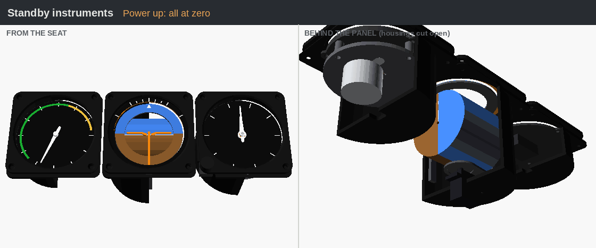
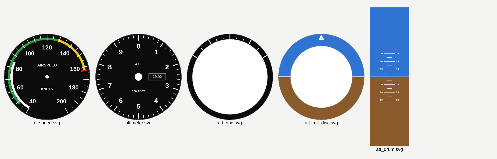

# Standby instruments

The standby airspeed, attitude and altimeter below the G1000 screens, as **working mechanical gauges**. Real needles and a real moving horizon, driven from the sim by MobiFlight (board 3 in [`firmware/G1000_WIRING.md`](../../firmware/G1000_WIRING.md#standby-gauges)).

| Gauge | What moves it | How |
|---|---|---|
| **Airspeed** | X27.168 gauge stepper (the kind in car dashboards) | The needle sits straight on the motor shaft. The motor sweeps 315° and has a stop, which is the face's zero. |
| **Altimeter** | 28BYJ-48 stepper + ULN2003 board | The 100-ft hand turns with the motor (one turn = 1000 ft). A printed 10:1 gear train, like a clock's hour hand, turns the 1000-ft hand on a tube round the 100-ft hand's arbor. A hall sensor finds zero at start-up. The knob is an EC11 encoder for the baro setting. |
| **Attitude** | Two SG90 micro servos | The roll servo turns a frame (±90°) carrying the sky/ground ring and the bank pointer. The pitch servo sits inside the horizon drum on that frame and turns it 2° per degree of pitch. The bank scale and the orange aircraft symbol stay still in front. |

## How each one is built

Every gauge has the same two halves:

- **Front case** (`case`, or `case_altimeter` with the knob hole): the square bezel on the panel face, with a short cup that fills the 80 mm panel hole and a seat for the glass (a 76.3 mm disc of 1 mm clear sheet; `panel-template/glass_cutout.svg` is the cutting guide).
- **Rear housing** (`asi_housing`, `alt_housing`, `att_housing`): an 86 mm tube behind the panel with a square flange. Four **M3 × 20 countersunk screws** go through the bezel corners, the panel and the flange, with nuts behind, and clamp the whole instrument to the panel. The altimeter has 3, because its knob takes the fourth corner. The mechanism screws into the housing (3 × M3 × 6).

Print the cases and housings in black, face down / flange down as the STLs are laid out.

### Airspeed

| Qty | Item |
|---|---|
| 1 | X27.168 stepper |
| 1 each | Printed `case`, `asi_housing`, `asi_face_plate`, `asi_needle` (white) |

Glue the paper face (`faces/airspeed.svg`) on `asi_face_plate`, push the X27's shaft through the centre hole from behind and glue the motor on (hot glue or epoxy). Screw the plate into the housing. Press the needle on so it points just below 40 kt while the motor is against its stop. The needle hub's hole is set by `x27_shaft_d` (1 mm); open it with a 1 mm drill if it's too tight.

### Altimeter

| Qty | Item |
|---|---|
| 1 | 28BYJ-48 5 V stepper + ULN2003 driver board |
| 1 | A3144 hall switch + 3 × 2 mm magnet |
| 1 | EC11 encoder (single) + a knob |
| 2 | 3 mm steel or brass rod: arbor 19 mm, lay shaft 13 mm |
| 1 each | Printed `case_altimeter`, `alt_housing`, `alt_front_plate`, `alt_back_plate`, `alt_arbor_gear`, `alt_hour_wheel`, `alt_lay_gear`, `alt_motor_pinion`, `alt_hand_100`, `alt_hand_1000` (hands in white) |
| 3 + 2 | M3 × 16 screws for the plate pillars, M4 × 6 for the motor |

Gears (module 1 and 0.8): motor pinion 20T → centre wheel 20T (1:1); arbor pinion 12T → lay wheel 40T, lay pinion 13T → hour wheel 39T, which gives 10:1. Print the gears with 0.12 mm layers for clean teeth.

1. Screw the 28BYJ-48 to the back of `alt_back_plate` (M4 into its ears) and press the pinion onto its shaft.
2. Push the arbor rod into the back plate's blind hole, then fit the arbor gear (with the magnet glued in its back face) and the lay gear on its shaft. Glue the hall sensor into its pocket, flat side up.
3. Slide the hour wheel's tube over the arbor, put the front plate on (pillars into its holes) and screw the plates together.
4. Glue the paper face (`faces/altimeter.svg`) on the front plate. Press the 1000-ft hand onto the tube, then the 100-ft hand onto the arbor, both pointing at 0 with the magnet over the sensor.

### Attitude

| Qty | Item |
|---|---|
| 2 | SG90 (or MG90S) micro servos, with their round horns |
| 1 each | Printed `case`, `att_housing`, `att_ring` (orange), `att_roll_frame`, `att_drum` |

1. Glue the paper bank scale (`faces/att_ring.svg`) on `att_ring` and glue the ring into the cup just behind the glass, with the aircraft symbol's stem at the bottom.
2. Glue `faces/att_roll_disc.svg` on the roll frame's front disc, sky up.
3. Screw the pitch servo into the bracket inside the frame, shaft pointing right. Wrap `faces/att_drum.svg` round the drum, sky toward the top and the horizon line at the front with the servo centred. Screw the drum's closed end to the servo's round horn.
4. Screw the roll servo through the housing's back wall (tabs on the wall, shaft forward) and screw the frame's back plate to its round horn, centred. Leave slack in the pitch servo's cable, because the frame turns ±90°.

## Faces

Print [`faces/*.svg`](faces) at **100 %** on photo paper and cut them out. The airspeed arcs are the 172S ones in knots: white 40–85, green 48–129, yellow 129–163, red line at 163. To change them, edit and run `python3 make_faces.py`.

## Before you print

- **Measure your X27.168:** the shaft diameter and length (`x27_shaft_d`, `x27_shaft_h`) and where its body sits. It's glued, so only the shaft has to line up.
- **Servos:** SG90 sizes vary a little. The brackets are drawn for a 22.5 × 12.2 mm body with 32.2 mm tabs.
- **Space behind the panel:** the airspeed housing is 28 mm deep, the altimeter 48 mm, and the attitude about 95 mm (its roll servo sticks out the back).

Nothing here has been printed or wired yet.
