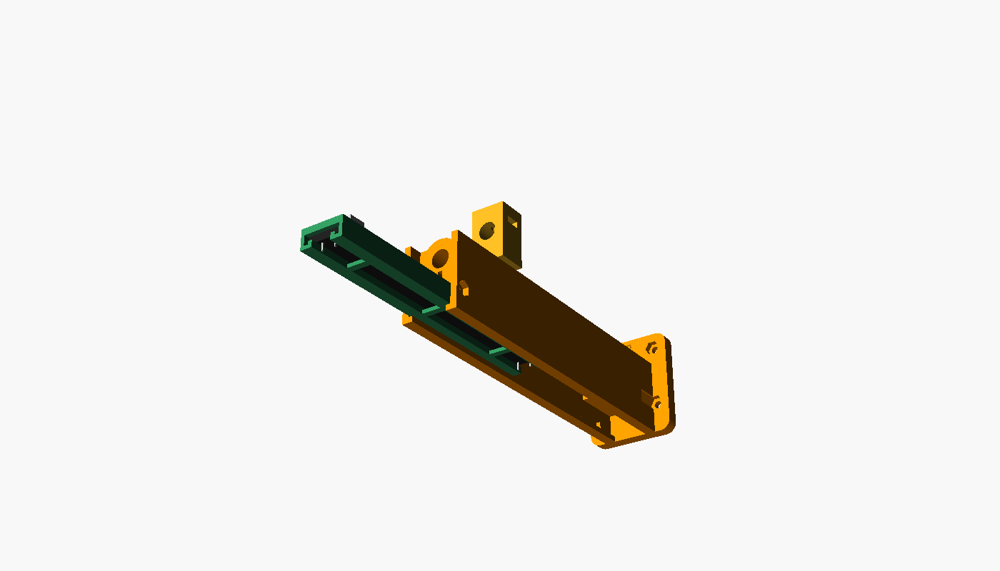
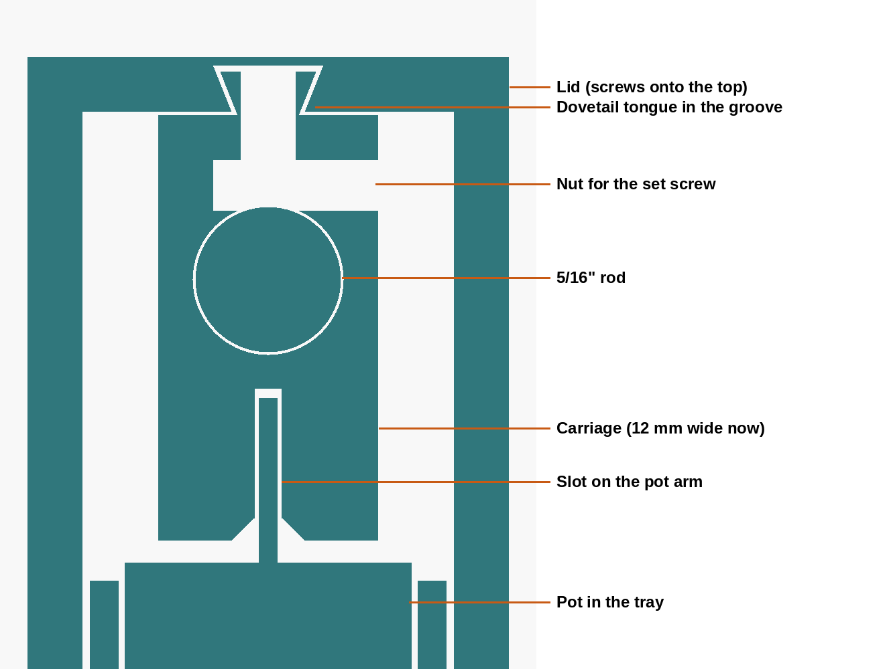
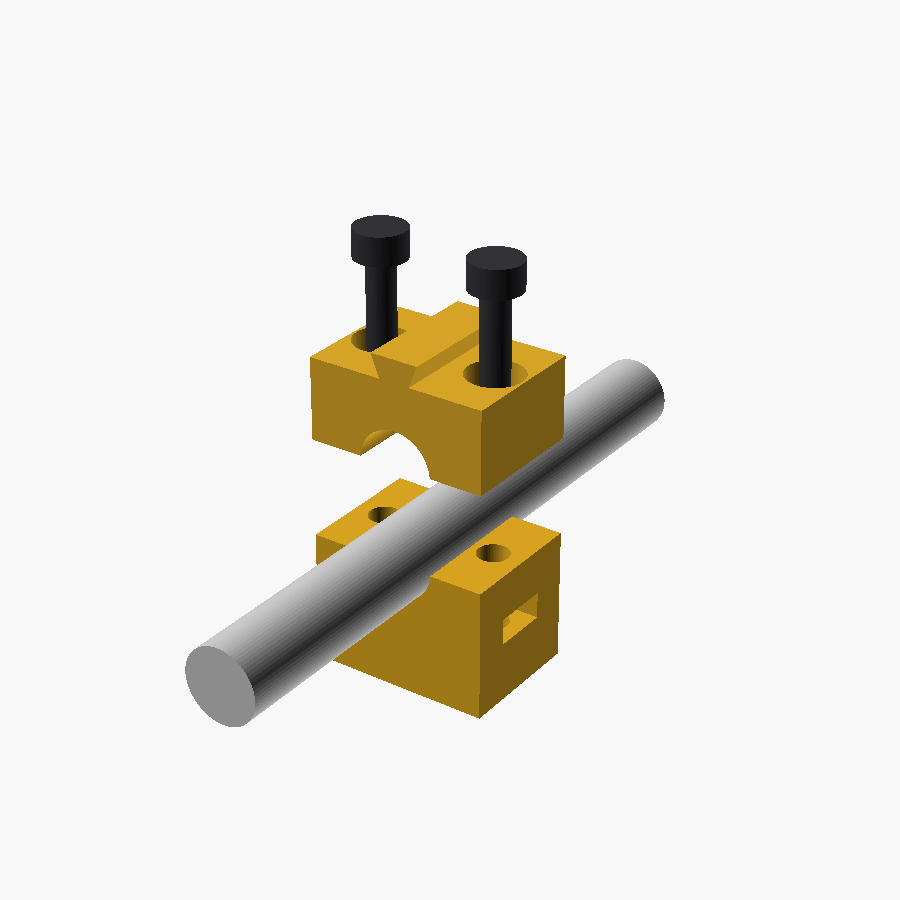

# Throttle (and the shared push-pull mechanism)

**Download:** [throttle_files.zip](https://github.com/SFXShannon/c172-home-sim/raw/main/parts/throttle/throttle_files.zip) (STLs, panel template, source) · or [all three + test plate](https://github.com/SFXShannon/c172-home-sim/raw/main/parts/push-pull-test-plate/throttle_mixture_prop_all.zip)

Throttle, mixture and prop all use the same simple mechanism. Only the knob and the panel nut change:

| Control | Knob | Panel nut | Folder |
|---|---|---|---|
| **Throttle** | Smooth round knob with a flat face. Print it black, or cream for older 172s | Knurled friction-lock nut | here |
| **Mixture** | Red, fine ribs around the edge, lock button in the centre (vernier style) | Hex bushing nut | [`../mixture`](../mixture) |
| **Prop** | Blue, crenellated edge (172RG / 182 / constant-speed) | Hex bushing nut | [`../prop`](../prop) |

| Pushed in | Pulled out | Behind the panel |
|---|---|---|
|  |  |  |

## How it works (kept simple)

- **Shaft:** a 5/16" (7.94 mm) smooth steel rod (drill rod, ground rod or a straight piece of cold-rolled round from the hardware store). 8 mm printer rod also works: set `rod_d = 8`. It only runs from the knob, through the front bushing, into the carriage, so it's short (170 mm) and nothing sticks out the back. Or **print it**: see [Printed rod](#printed-rod-instead-of-steel) below.
- **Friction:** a size 011 O-ring (0.301" ID × 0.070", the 5/16" O-ring in hardware-store assortments) in the front bushing holds the knob wherever you leave it, like the friction lock on the real throttle.
- **Sensor:** the slide pot drops into a printed **tray**, and the tray slides into the housing from the back. A printed carriage clamped to the rod with an M3 set screw has a slot underneath that fits over the pot's flat arm. It's drawn for the Fielect **128 mm** fader: 10K linear, 100 mm travel, body 128 × 15.7 × 6.9 mm, arm 9 mm tall × 8 mm long (along the travel) × 1 mm thick (`pot_lever_h`, `pot_lever_len`, `pot_lever_t`).
- **Carriage and lid:** a lid screws onto the top of the housing (4 × M3 × 10). A dovetail tongue on top of the carriage rides in a groove under the lid, which locks it side to side, up and down and against twisting, and holds up the back end of the rod. The carriage is a two-piece clamp: the rod sits between the lower half (`carriage`, with the arm slot) and the top half (`carriage_cap`, with the tongue), and two M3 × 14 socket-head screws, one each side of the tongue, pull them together. The screw heads sink into the top half below the lid, so nothing sticks up into the groove. The rear block is just the end stop. (For the old long rod that also runs through the rear block, set `rod_through = true`.)
- **Tray:** open underneath, and completely open for the last 12 mm at each end, so the pins hang free wherever they are. The pot sits on two ribs, so the little tabs along its bottom edge hang beside them. The tray rides on two ledges in the housing, the bushing blocks hold the pot down from above, and one M3 screw across the back of the housing stops it sliding out. No zip ties.
- **Travel:** 96 mm (`control_travel`), set by the bushings. That uses nearly all of the pot's 100 mm travel (2 mm spare at each end, so the carriage stops before the pot's own end stops). The housing reaches about 163 mm behind the panel.

## Parts list (per control)

| Qty | Item | Notes |
|---|---|---|
| 1 each | Printed: `knob`, `escutcheon`, `housing`, `tray`, `carriage`, `carriage_cap`, `lid` | [`stl/`](stl) |
| 1 | 5/16" smooth steel rod, 170 mm (6 5/8"), **or** the printed `grey_rod` | OpenSCAD prints the exact length. Cut it with a hacksaw and file the ends; take any burr off so it slides through the bushings. |
| 1 | Slide potentiometer, 10 kΩ linear, 128 mm long / 100 mm travel (e.g. Fielect 128 mm fader) | Sits in the tray. Measure yours and set `pot_len`, `pot_w`, `pot_h`, `pot_lever_h`, `pot_lever_len`, `pot_lever_t`, `pot_travel` if they differ |
| 1 | O-ring, size 011 (0.301" ID × 0.070") | For friction. A metric 8 × 2 mm O-ring also fits if you set `oring_cs = 2` |
| 2 + 2 | M3 × 14 socket-head screws + M3 nuts | Carriage clamp |
| 4 | M3 × 10 screws | Lid |
| 4 + 4 | M3 × 14 countersunk screws + M3 nuts | Panel mount |
| 1 + 1 | M3 × 30 screw + M3 nut | Across the back of the housing, keeps the tray in |

## Printing

No supports needed.

- **housing:** lies on its ledges (open side down). If the rod bores come out tight, ream them with an 8.5 mm (or 21/64") drill.
- **knob:** the throttle prints face-down; the mixture and prop print back-down. For the mixture, use a colour change to make the button black, or paint it.
- **escutcheon:** prints front face down.
- **tray:** prints floor down. The end bars bridge across the top.
- **carriage** and **carriage_cap:** print standing on one end, so the rod bore, arm slot and tongue are vertical.
- **lid:** prints top face down, groove up.

### Printed rod instead of steel

`grey_rod.stl` is a printed stand-in for the steel rod: same 5/16" diameter, already the right length for that control (throttle 170 mm, mixture and prop 168 mm), with chamfered ends so it doesn't nick the O-ring. Print it in **grey** so it looks like the steel one.

- **Prints lying down** on a 0.4 mm flat (`rod_flat`). The layers run the whole length, so it's strong and the layer lines run the same way it slides. Don't stand it up: printed upright it snaps at a layer line the first time the knob gets knocked sideways.
- **Material:** PETG, ASA or PA-CF. PLA works but can take a bend over time.
- **Settings:** 4–5 walls, 100 % infill, no supports. A brim helps it stay down on such a long, thin footprint.
- **Fit:** it should slide through the bushings with the same 0.4 mm clearance as steel. If it's tight, sand it lightly lengthwise; if it's loose in the knob, the glue takes up the gap.
- **Stiffer option:** set `rod_core_d = 3` and re-export. That leaves a hole down the middle for a 3 mm steel or carbon rod, glued in.
- **Assembly** is the same as steel. Put the flat facing down when you clamp it in the carriage. The carriage screws only need to be snug: overtightening crushes a printed rod.

## Assembly

1. Solder the wires to the pot first. Then drop the pot into the tray with the arm up.
2. Slide the tray into the back of the housing on its ledges, arm first. The arm passes through the slot in the rear bushing block. Push it in until the tray hits the front stops, then put the M3 × 30 screw and nut across the back of the housing.
3. Seat the O-ring in the groove inside the front bushing. Drop the carriage in from the top so its slot sits over the pot's arm.
4. Push the two M3 nuts into the side slots of the lower carriage half, then drop it in from the top so its slot sits over the pot's arm. Slide it back against the rear block. Push the rod in from the front, through the bushing, along the half-round seat in the carriage, until its end is about 1 mm short of the carriage's back face. Put the top half on, tongue up, and tighten the two M3 × 14 screws straight down from the top.
5. Slide the lid on from the back so the carriage's tongue goes into its groove, then screw it down with the 4 × M3 × 10 screws.
6. Bolt the housing behind the panel with "UP" at the top. Push the escutcheon into the hole, then glue the knob onto the rod (CA or epoxy).

To swap a pot later: take the lid off, take out the two carriage screws and the top half, pull the rod out, lift the carriage out, take out the back screw and slide the tray out.

## Wiring and sim

Wire the pot ends to 5V and GND, and the wiper to an analog input. With the Pro Micro sketch in [`/firmware`](../../firmware): throttle on A0 (X axis), mixture on A1 (Y axis), prop on A2 (Z axis).

In MSFS, bind the axes to *Throttle axis*, *Mixture axis* and *Propeller axis*. If one works backwards, use the reverse option in MSFS or the `REVERSE_` setting in the sketch.

**Note:** the GP-Wiz is a button board, so it can't read these pots. That's why the Pro Micro sketch is included.
