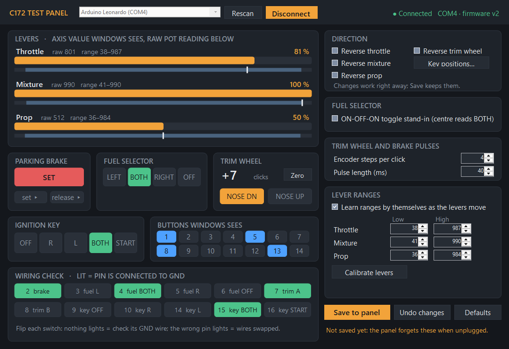

# C172 Test Panel app (Windows)

Test and set up the [push-pull test panel](../../parts/push-pull-test-plate) without re-uploading the sketch. It talks to the Pro Micro over its USB serial port, alongside the joystick Windows already sees.



**Download:** [`release/C172-Test-Panel.zip`](release/C172-Test-Panel.zip). Unzip anywhere and run `C172 Test Panel.exe`. It needs nothing installed: it uses .NET Framework 4.8, which comes with Windows 10 and 11. Keep the `.exe.config` file next to the exe so it stays sharp on high-DPI screens.

## First time

1. Upload the latest [`test_panel.ino`](../../parts/push-pull-test-plate/firmware/test_panel/test_panel.ino) (firmware v2 or later). Older uploads don't have the serial link, and the app will say the panel "doesn't answer".
2. Run the app. It finds the panel by itself; otherwise pick its port (it shows up as **Arduino Leonardo**) and click **Connect**.

It only knocks on Leonardo-type ports by itself, so it leaves other Arduinos, SimHub boards and wheel bases alone. If you unplug the panel or re-upload the sketch, it reconnects when the port comes back. Close the Arduino IDE's Serial Monitor first: only one program can have the port open.

## Testing

- **Levers:** the orange bar is the axis value Windows and MSFS see. Under it, the raw pot reading (white tick) sits on the learned range (blue).
- **Parking brake, fuel selector, ignition key, trim wheel:** light up as you move them. The trim count goes up for nose down; *Zero* resets it.
- **Buttons Windows sees:** buttons 1–14 exactly as MSFS gets them. Hover one for what it does.
- **Wiring check:** one lamp per switch pin, lit when that pin is connected to GND. Nothing lights when you flip a switch: check its GND wire. The wrong pin lights: two wires are swapped.

## Setup

Changes take effect straight away, so you can try them. **Save to panel** writes them to the Pro Micro's EEPROM so they survive unplugging; **Undo changes** goes back to what's saved; **Defaults** goes back to the settings at the top of the sketch (lever ranges stay).

- **Direction:** reverse throttle, mixture, prop, the trim wheel or the ignition key.
- **Fuel selector:** the ON-OFF-ON toggle stand-in (centre reads BOTH).
- **Trim wheel and brake pulses:** encoder steps per click (4 for most EC11s; try 2 if it skips clicks) and how long each pulse is held.
- **Lever ranges:** click **Calibrate levers**, move every lever all the way in and out, then **Use these ranges**. A lever that didn't move keeps its old range. You can also type the low and high readings. With *Learn ranges by themselves* on, a range still grows if a lever goes past it; turn it off to keep exactly the range you set.

If something goes wrong, the app keeps a short log in `%LOCALAPPDATA%\C172TestPanel\log.txt`.

## Build it yourself

With the .NET SDK installed:

```
cd tools\test-panel-app
dotnet build -c Release
```

The exe lands in `bin\Release\net48`. `"C172 Test Panel.exe" --screenshot shot.png` renders the window with sample values (that's how the picture above is made).

## How it talks to the sketch

Plain text lines at 115200 baud, DTR on. The full command list is in the comment above `runCommand()` in `test_panel.ino`: `HELLO`, `GET`, `SET <name> <value>`, `SAVE`, `LOAD`, `DEFAULTS` and `STREAM 1|0`. While streaming, the sketch sends a `D,…` line about 25 times a second with the raw and output lever values, the button and pin masks and the trim count.
